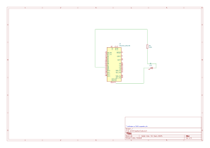

# Blinking LED with Arduino Uno

Jut using this as practice to learn more about embedded systems and how electronics work.
Also learning how to read and make schematic diagrams along with documenting my work.

## Demo

## Hardware
* 1x Arduino Uno R3
* 1x 5mm LED
* 1x 220Ω resistor
* Breadboard & jumper wires

## Schematic Diagram

## Concepts I Learnt
* Digital GPIO output (`pinMode` / `digitalWrite` and bare-metal `DDRB` / `PORTB` registers)
* Current-limiting resistor sizing for LEDs
* Breadboard power/ground rail wiring

## How to Run
1. Wire the circuit as shown in the schematic above.
2. Open `src/.ino cde/blinkingled.ino` in the Arduino IDE or you can use the `src\embedded c code\ blinkindled.c` for the bare metal c code you can run in vscode.
3. Select **Arduino Uno** and your COM port, then click **Upload** for the Arduino IDE.